```
██████╗ ██╗   ██╗██████╗  ██████╗     ███████╗████████╗██╗   ██╗██████╗ ██╗ ██████╗ 
██╔══██╗╚██╗ ██╔╝██╔══██╗██╔═══██╗    ██╔════╝╚══██╔══╝██║   ██║██╔══██╗██║██╔═══██╗
██████╔╝ ╚████╔╝ ██████╔╝██║   ██║    ███████╗   ██║   ██║   ██║██║  ██║██║██║   ██║
██╔═══╝   ╚██╔╝  ██╔══██╗██║   ██║    ╚════██║   ██║   ██║   ██║██║  ██║██║██║   ██║
██║        ██║   ██║  ██║╚██████╔╝    ███████║   ██║   ╚██████╔╝██████╔╝██║╚██████╔╝
╚═╝        ╚═╝   ╚═╝  ╚═╝ ╚═════╝     ╚══════╝   ╚═╝    ╚═════╝ ╚═════╝ ╚═╝ ╚═════╝ 
```

<p align="center">
  <strong>🔥 Native, Ultralight, High-Performance Client for MariaDB, MySQL & SQLite</strong>
  <br />
  <em>Built with Tauri v2 (Rust) + React 19 (TypeScript & Tailwind CSS)</em>
  <br />
  <a href="README.md">Español</a> · <strong>English</strong>
</p>

<p align="center">
  
  
  
  
  
  
  
  
</p>

<p align="center">
  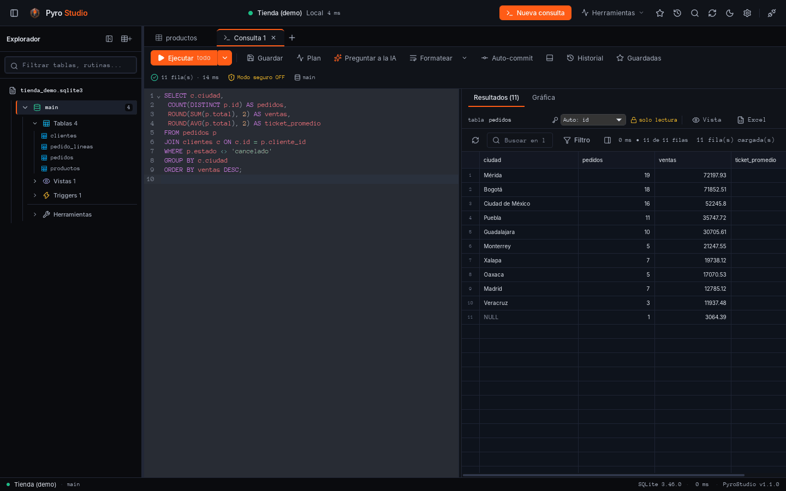
</p>

---

## 📌 What is PyroStudio?

**PyroStudio** is a native desktop GUI client purpose-built for database administrators (DBAs) and software developers who demand instant speed, strict credential security, and advanced diagnostics for **MariaDB and MySQL**, as well as **SQLite** files—without the heavy memory footprint or sluggishness of traditional Electron- or Java-based tools.

Unlike generic database clients, PyroStudio natively integrates:
- **Hardened binary HTTP tunnel (PHP)** for servers behind strict firewalls or WAFs.
- **True out-of-band query cancellation** (`KILL QUERY`) over both direct connections and HTTP tunnels.
- **Defense-in-depth Safe Mode** with syntactic analysis of potentially destructive statements.
- **Hardware-accelerated Canvas Data Grid (60 FPS)** for browsing millions of cells with inline editing.
- **Performance diagnostics suite:** visual EXPLAIN, heuristic Index Advisor, `slow_log` viewer, and interactive session termination (`KILL CONNECTION`).
- **Full bilingual UI & AI responses (English / Español):** switch languages anytime from the initial tour or Preferences → Appearance.

---

## 📸 Screenshots

> Screenshots were captured using the built-in **SQLite demo database** (*Try the demo* button on the welcome screen), expanded with sample data. You can explore it without setting up any server.

<table>
  <tr>
    <td width="50%">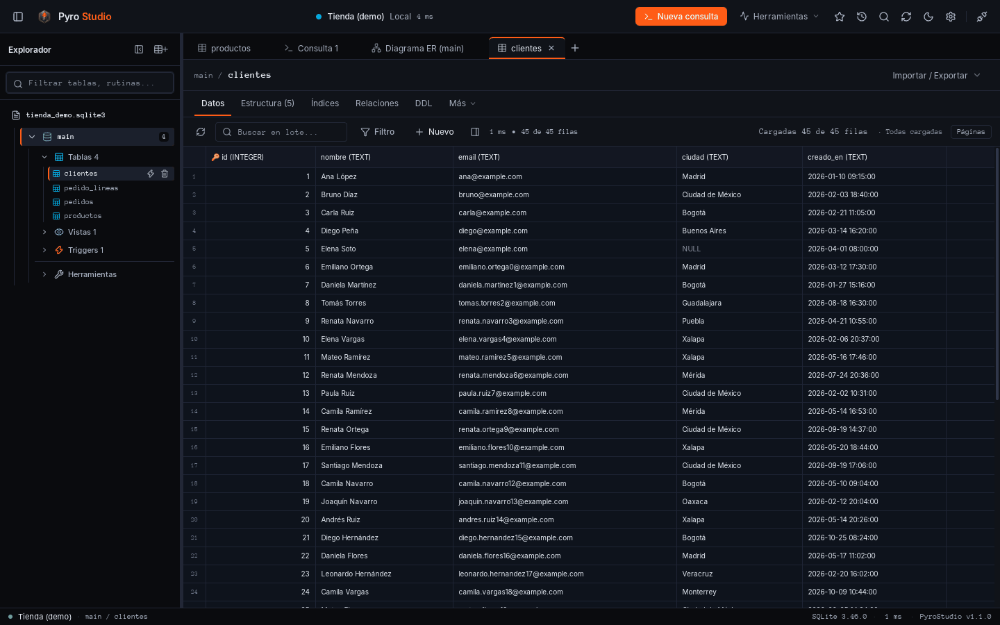</td>
    <td width="50%">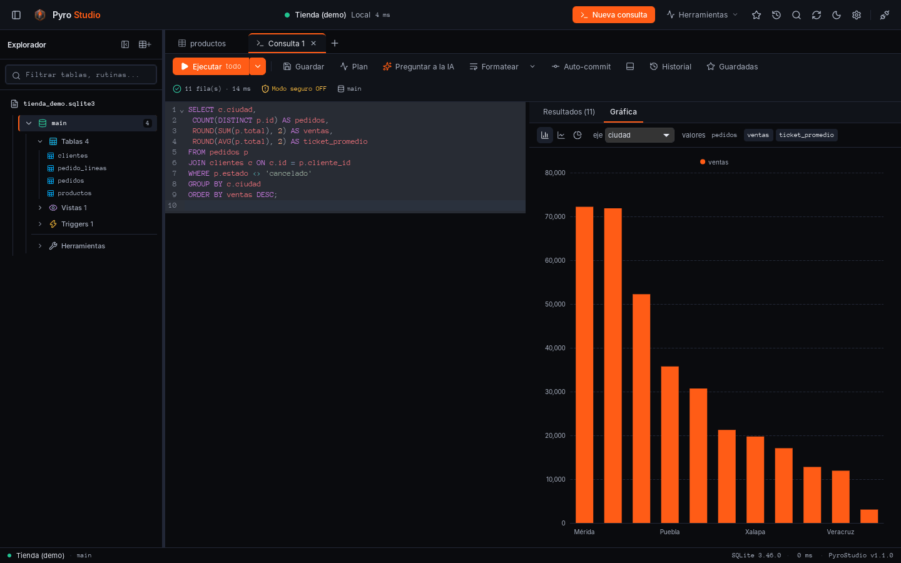</td>
  </tr>
  <tr>
    <td><b>Canvas Data Grid</b> — smooth navigation across thousands of rows, inline editing, and visual filters.</td>
    <td><b>Instant Charts</b> — turn any query result into bar, line, or pie charts in one click.</td>
  </tr>
  <tr>
    <td>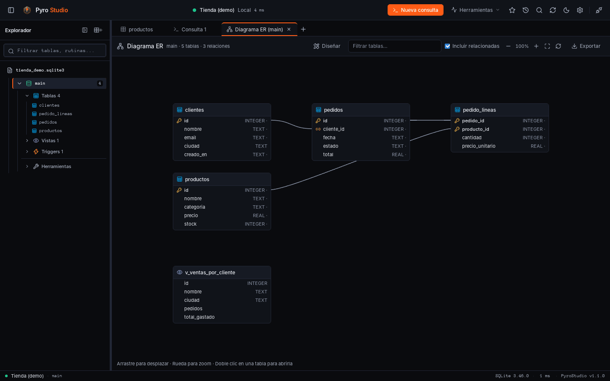</td>
    <td>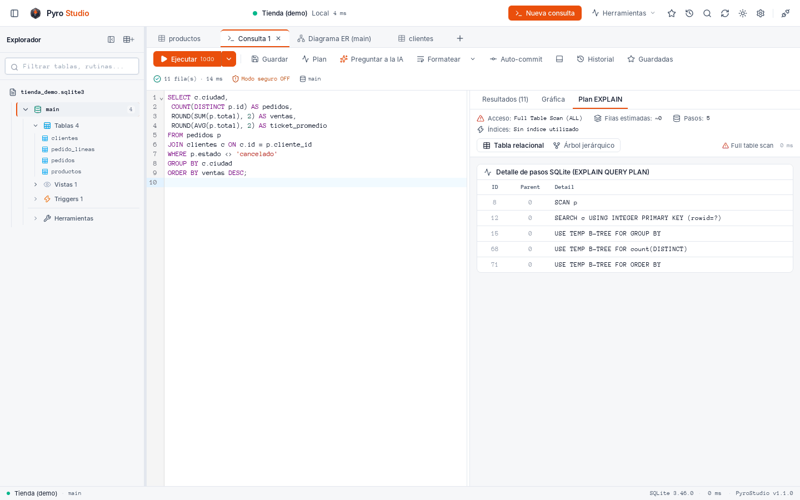</td>
  </tr>
  <tr>
    <td><b>ER Diagram</b> — automatically generated tables, views, and relationships; exportable.</td>
    <td><b>EXPLAIN Plan</b> — spots <i>full table scans</i> and index usage (shown here in light theme).</td>
  </tr>
  <tr>
    <td>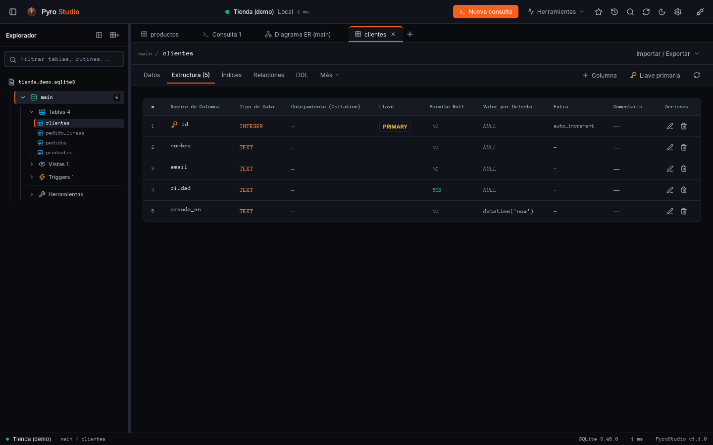</td>
    <td>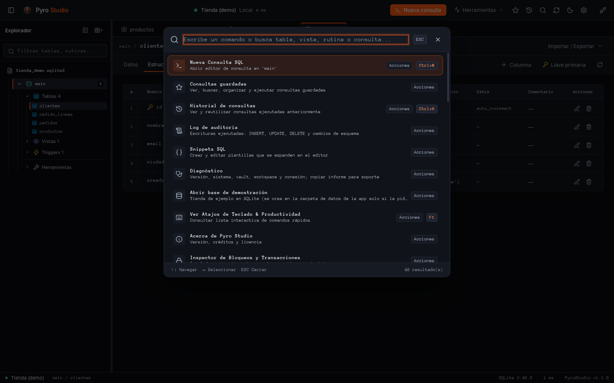</td>
  </tr>
  <tr>
    <td><b>Schema Designer</b> — editable columns, keys, and default values with live DDL preview.</td>
    <td><b>Command Palette</b> (<code>Ctrl+K</code>) — any action, table, or query a keystroke away.</td>
  </tr>
</table>

### 🤖 AI Assistants

<table>
  <tr>
    <td width="50%">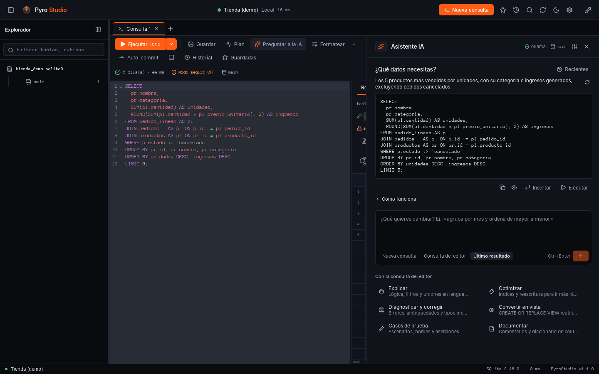</td>
    <td width="50%">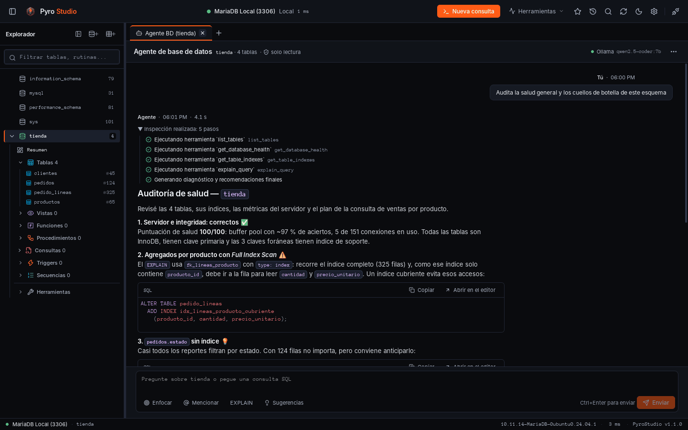</td>
  </tr>
  <tr>
    <td><b>Natural Language → SQL</b> — describe the data you need and the assistant writes the query using your real schema; insert or run it in one click.</td>
    <td><b>Database Agent</b> — inspects tables, indexes, server health, and <code>EXPLAIN</code> plans with read-only tools and delivers a diagnostic report with reviewable scripts (MariaDB/MySQL).</td>
  </tr>
  <tr>
    <td>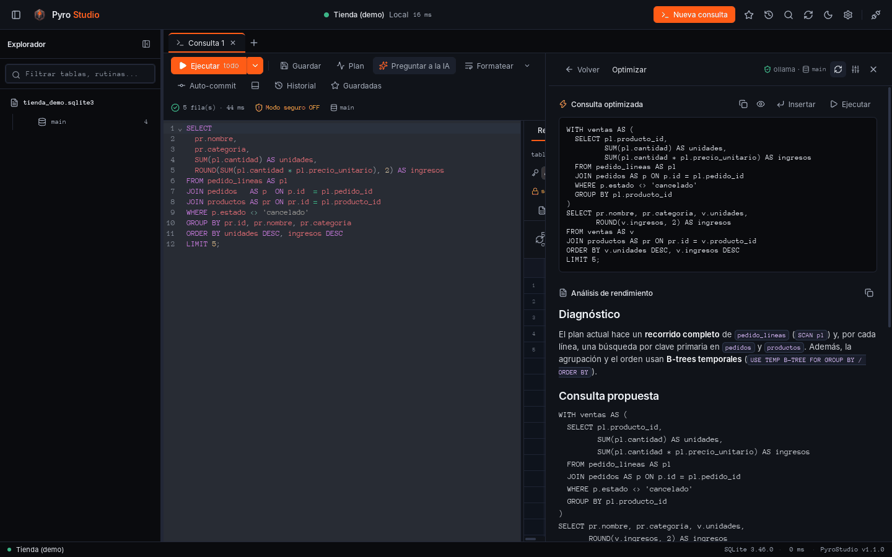</td>
    <td>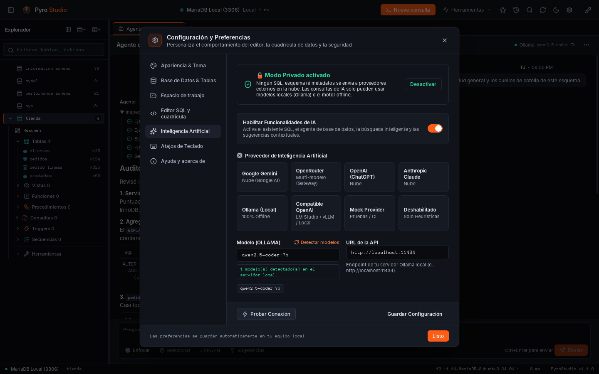</td>
  </tr>
  <tr>
    <td><b>Explain, Optimize, Fix & Document</b> — one-click actions on your editor query: rewrites, index suggestions, edge-case tests, and technical docs.</td>
    <td><b>Bring Your Own Model</b> — Gemini, OpenAI, Anthropic, OpenRouter, Ollama, or any OpenAI-compatible endpoint. <b>Privacy Mode</b> restricts AI strictly to local models.</td>
  </tr>
</table>

> The AI outputs shown in these screenshots are illustrative and were generated against a local Ollama-compatible mock endpoint.

### 🩺 Diagnostics & Safety

<table>
  <tr>
    <td width="50%">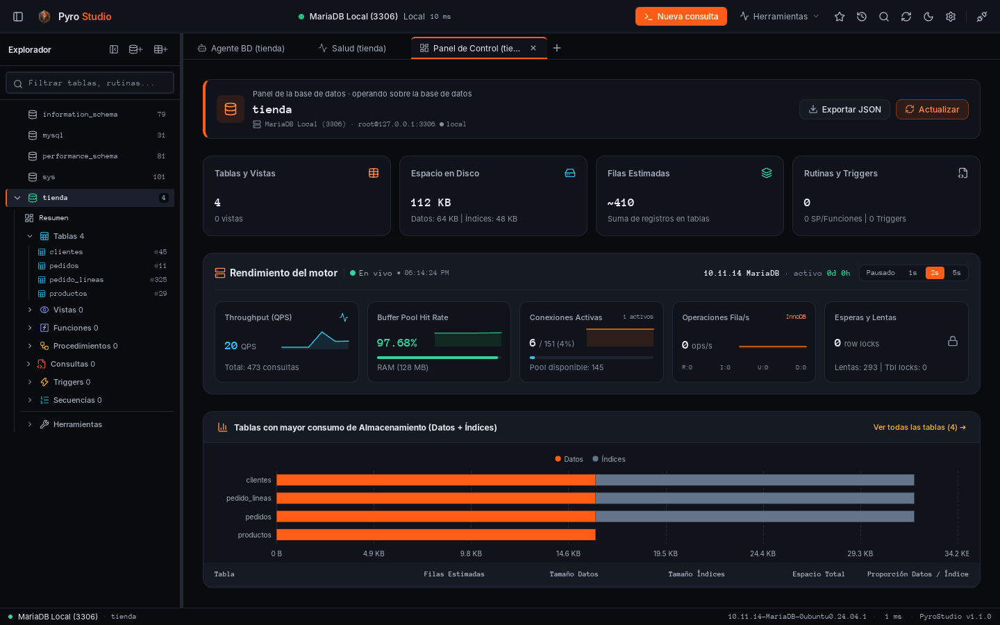</td>
    <td width="50%">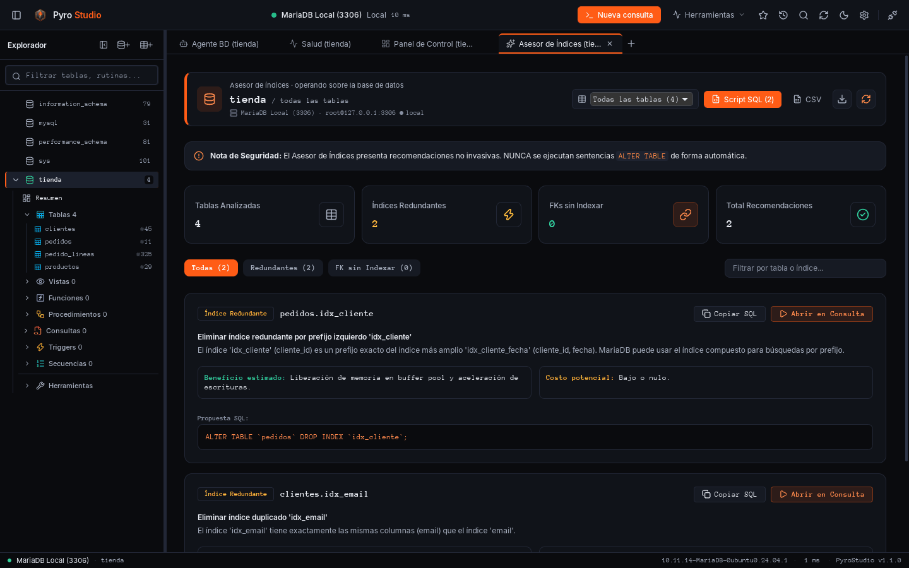</td>
  </tr>
  <tr>
    <td><b>Dashboard</b> — live QPS, buffer pool hit rate, connections, and lock waits, plus storage breakdown per table.</td>
    <td><b>Index Advisor</b> — detects redundant indexes and unindexed foreign keys with proposed <code>ALTER TABLE</code> scripts (never executed automatically).</td>
  </tr>
  <tr>
    <td>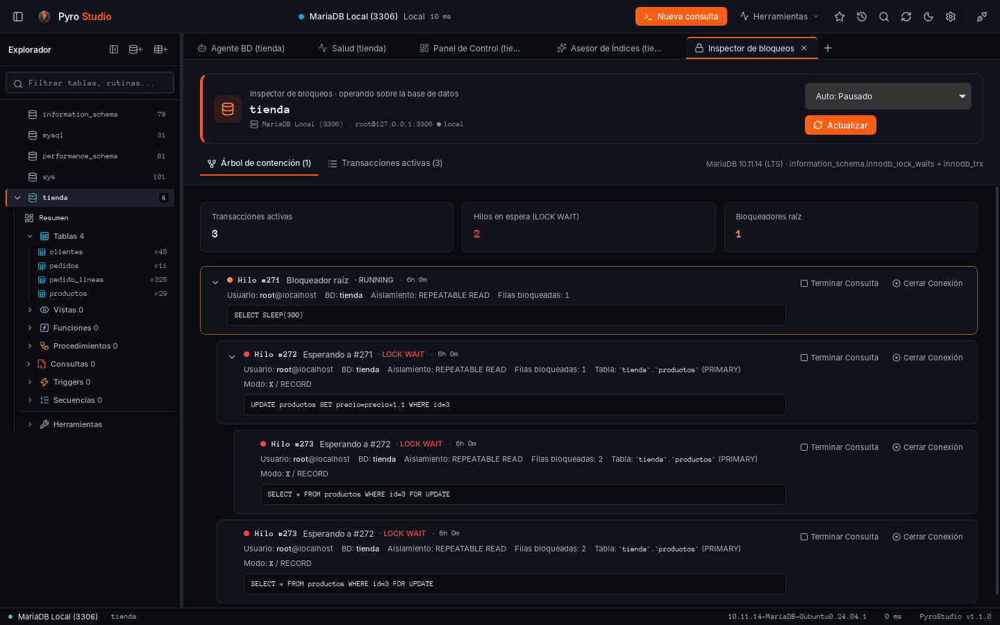</td>
    <td>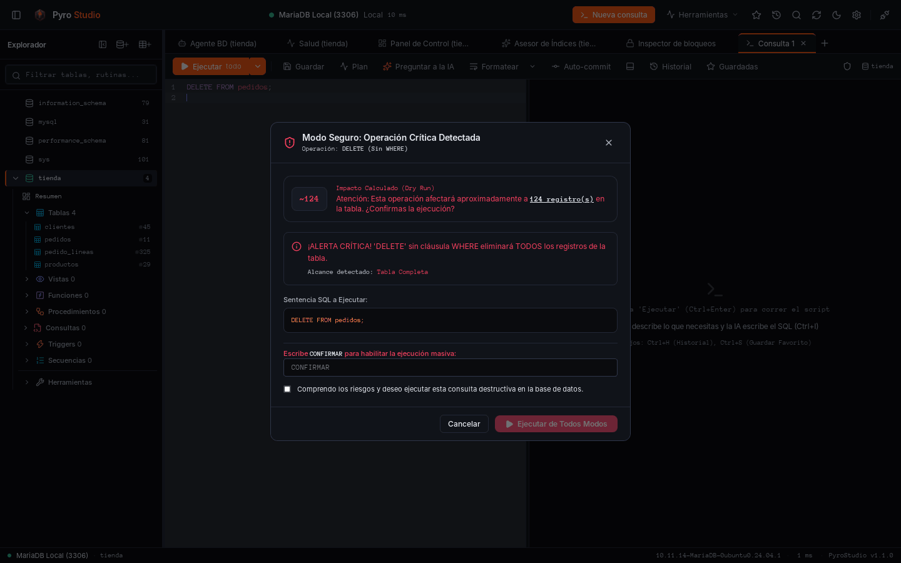</td>
  </tr>
  <tr>
    <td><b>Locks Inspector</b> — contention tree showing who blocks whom, with one-click <code>KILL QUERY</code> / <code>KILL CONNECTION</code>.</td>
    <td><b>Safe Mode</b> — intercepts destructive statements, estimates impact via <i>dry run</i>, and requires explicit confirmation.</td>
  </tr>
</table>

### 🔄 Cross-Connection Migration & Data Transfer

<p align="center">
  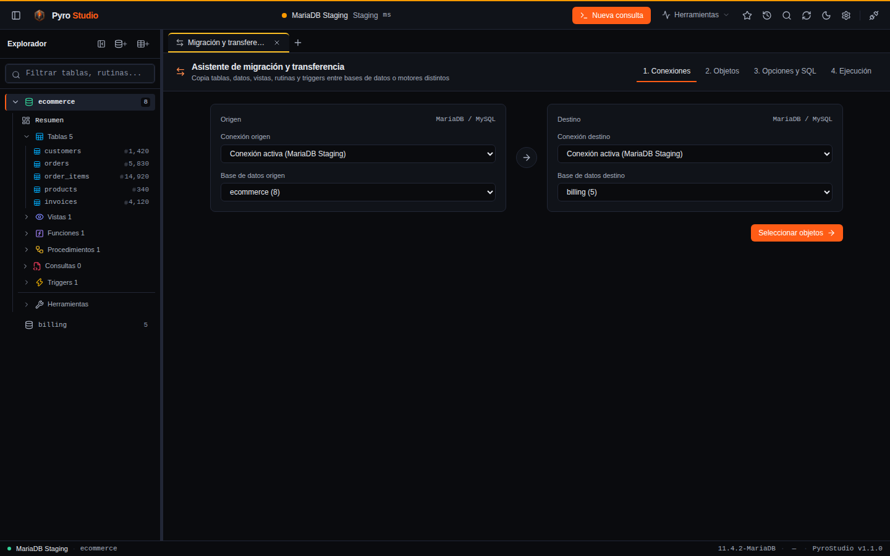
</p>

> **4-Step Migration Wizard** — transfers tables (structure, data, or both), views, routines, triggers, and events across databases and saved connections, with automatic type and DDL translation between **MariaDB/MySQL ↔ SQLite**, SQL preview, and real-time progress.

---

## 💻 System Requirements & Compatibility

### Supported Operating Systems
- **Windows:** Windows 10 (1809+) and Windows 11 (x64 / ARM64). Requires *Microsoft Edge WebView2* (preinstalled on Windows 11 and up-to-date Windows 10).
- **macOS:** macOS 11 Big Sur, macOS 12 Monterey, macOS 13 Ventura, macOS 14 Sonoma or newer (Apple Silicon M1/M2/M3/M4 and Intel x64).
- **Linux:** Ubuntu 22.04+, Debian 11+, Fedora 38+, Arch Linux. Requires WebKitGTK 4.1 (`libwebkit2gtk-4.1-0`).

### Supported Database Engines
- **MariaDB:** 10.3, 10.4, 10.5, 10.6, 10.11 LTS, 11.0, 11.4 LTS or newer.
- **MySQL:** 5.7, 8.0, 8.4 LTS, 9.0 or newer.
- **Percona Server / AWS Aurora MySQL:** Fully compatible over the standard MySQL protocol.
- **SQLite:** `.db`, `.sqlite`, `.sqlite3`, and `.db3` files (bundled SQLite 3, zero system dependencies), local or via the `tunnel/pyro_tunnel_sqlite.php` HTTP tunnel.

### SQLite Support & Features
- **Engine support:** Local or remote SQLite 3 files via `tunnel/pyro_tunnel_sqlite.php`.
- **Inspection & browsing:** Explorer for tables, columns, indexes, foreign keys, triggers, and views.
- **Safe editing via `rowid`:** Tables without an explicit primary key can be safely edited via `rowid` (shown as the leading identifier column).
- **Schema modifications (DDL):** Transparent table rebuilds following the [official 12-step procedure](https://www.sqlite.org/lang_altertable.html#otheralter) with full SQL script preview before applying.
- **EXPLAIN QUERY PLAN:** Built-in hierarchical parser with tree and table visualizations.
- **Non-blocking hot backup:** Instant backup via `VACUUM INTO` without blocking concurrent readers.
- **Excel import & export:** SQLite dialect support (`INSERT OR IGNORE`, `ON CONFLICT DO UPDATE`, native SQLite types).
- **SQLite-aware AI assistant:** Direct schema introspection without relying on `information_schema`.
- **Adapted Safe Mode:** Classifies `PRAGMA` statements distinguishing read-only inspections from configuration changes.

### SQLite Limitations
- No users/privileges, routines, events, sequences, partitions, system-versioned tables, health monitor, process list, or schema diff: the UI automatically hides unsupported features via `ServerCapabilities`.
- A single database connection is used per open file (to keep `ATTACH`, `TEMP` tables, and `PRAGMA` state consistent), so very long-running queries hold the connection until completed or cancelled.
- Over the HTTP tunnel, each request opens the file independently (`ATTACH` does not persist across requests) and out-of-band cancellation is not supported.

---

## 📥 Installation

### Prebuilt Binaries
Download the installer or binary for your platform from [GitHub Releases](https://github.com/cgarciagl/PyroStudio/releases):

- **Windows:**
  - `Pyro-Studio_Setup.exe` (Standard NSIS installer)
  - `Pyro-Studio.msi` (Enterprise MSI installer for Group Policy / MDM)
  - `PyroStudio_vX.Y.Z_x64_portable.exe` (Portable executable — no installation or admin rights required)
    - Requires **Microsoft Edge WebView2** (included in Windows 11 and most Windows 10 systems). If it fails to launch, install the [WebView2 Runtime](https://developer.microsoft.com/microsoft-edge/webview2/) or use one of the installers.
    - "Portable" means no installation is required: connections, preferences, and encrypted credentials are still stored in your user profile and Windows Credential Manager, not next to the `.exe`.
- **macOS:**
  - `Pyro-Studio.dmg` (Universal binary: Apple Silicon & Intel. Drag and drop to `Applications`)
- **Linux:**
  - `pyro-studio.AppImage` (Portable executable: `chmod +x` and run)
  - `pyro-studio_amd64.deb` (Debian / Ubuntu: `sudo dpkg -i pyro-studio_amd64.deb`)

### First Launch (Unsigned Binaries)
PyroStudio is open-source software whose binaries are built automatically by GitHub Actions **without a commercial code-signing certificate** (Authenticode on Windows / Apple Developer ID on macOS). Your OS may show a one-time warning when opening a downloaded binary for the first time:

- **macOS:** Because the app is not notarized by Apple, macOS may report it as "damaged" or from an "unverified developer". After dragging it to `Applications`, run in Terminal:
  ```bash
  xattr -cr "/Applications/Pyro Studio.app"
  ```
  Alternatively, attempt to open it once and go to **System Settings → Privacy & Security → Open Anyway**.
- **Windows:** If SmartScreen appears ("Windows protected your PC"), click **More info → Run anyway**, or unblock the file beforehand via Properties → **Unblock** (or in PowerShell: `Unblock-File .\PyroStudio_*.exe`).
- **Linux (AppImage / `.deb` / `.rpm`):** No signing warnings. For AppImage, mark it executable with `chmod +x Pyro*.AppImage` (on recent Ubuntu releases, install `libfuse2` or `libfuse2t64` if needed).

---

## 🔌 First Connection Guide

When launching PyroStudio, the connection profile manager appears:

1. **Create Profile:** Click **New Connection** and assign a recognizable name (e.g., `Production Store`, `Local Dev`).
2. **Choose Environment:** Pick `Local`, `Development`, `Staging`, or `Production`.
   > [!IMPORTANT]
   > Connections marked as **Production** automatically enable reinforced visual alerts in the header and enforce Safe Mode confirmation on any potentially destructive operation.
3. **Connection Type:**
   - **Direct TCP:** Provide Host, Port (default `3306`), Username, Password, and optional default Database.
   - **SSH Tunneling:** Reach databases isolated in private networks through an SSH bastion host.
   - **HTTP Tunnel (PHP):** For shared hosting or web-only access. Upload `tunnel/pyro_tunnel.php` to your HTTP server and enter the tunnel URL.
     The script is secure by default: it **requires an auth token** (`PYRO_TUNNEL_TOKEN`, minimum 16 characters; without it every request is rejected) and only connects to `localhost` databases.
     1. Click **"Generate token"** in the "Tunnel token" field and copy the generated snippet to your server (`PYRO_TUNNEL_TOKEN=...` or `$tunnelToken = '...';`).
     2. If the database is on another host, add it to `PYRO_TUNNEL_ALLOWED_DB_HOSTS` (comma-separated): exact host (`db.example.com`), subdomains (`*.example.com`), CIDR (`10.0.0.0/8`), or `*`. Cloud metadata ranges (`169.254.0.0/16`, Alibaba, Oracle, AWS IPv6) and other special ranges are always blocked.
     3. Only ports `3306` and `3307` are allowed by default. For others, set `PYRO_TUNNEL_ALLOWED_DB_PORTS` (e.g., `3306,3300-3310` or `*`).
     4. For remote databases, encrypt the tunnel → database hop with `PYRO_TUNNEL_DB_TLS=preferred` or `required` (default `off`).
     5. After 5 invalid tokens from an IP within 5 minutes, the tunnel temporarily rate-limits it (HTTP 429). Configure with `PYRO_TUNNEL_RATE_LIMIT=off` or `PYRO_TUNNEL_TRUSTED_PROXY=1`.

     See the full `PYRO_TUNNEL_*` reference in [SECURITY.md](SECURITY.md#variables-de-entorno).
4. **TLS / SSL Security:**
   - By default, PyroStudio validates certificates against your system CA store.
   - You can attach a custom Certificate Authority (`Custom CA Path`).
   - Disabling TLS verification requires explicit confirmation to prevent MitM attacks.
5. **Test & Connect:** Click **Test Connection** to verify latency and credentials. Passwords are stored automatically in the local AES-256-GCM encrypted vault.

---

## 🛡️ Safe Mode & Technical Boundaries

PyroStudio implements a syntactic risk analyzer in `src-tauri/src/db/safe_mode.rs`:

- **Flagged Critical Operations:**
  - `DELETE` or `UPDATE` without a `WHERE` clause (or with `WHERE` only inside string literals).
  - `DROP TABLE`, `DROP DATABASE`, `DROP PROCEDURE`, `DROP TRIGGER`, `DROP INDEX`.
  - `TRUNCATE TABLE`.
  - Multi-statement batches hiding destructive commands after a semicolon.
- **Confirmation:** The confirmation modal estimates affected rows via dry run and requires typing the object name or explicitly accepting the risk before sending the statement.
- **Known Security Boundary:** *Safe Mode is a defense-in-depth safeguard against human mistakes, NOT an absolute security guarantee or a substitute for least-privilege database accounts.* Grant read-only (`SELECT`) privileges to accounts that do not need write access in production.

---

## ⚡ Out-of-Band Query Cancellation

- In the SQL editor (`QueryEditorTab`), each executed query receives a unique tracking ID (`query_id`).
- You can cancel long-running queries at any time via the **Cancel** button or by setting a configurable timeout (5s, 10s, 30s, 60s, 120s, or Unlimited).
- Cancellation propagates to the Rust backend, issuing a direct `KILL QUERY` against the MySQL/MariaDB thread over both direct TCP connections and the PHP HTTP tunnel.

---

## ⌨️ Key Keyboard Shortcuts

| Shortcut (Windows / Linux) | Shortcut (macOS) | Action | Description |
| :--- | :--- | :--- | :--- |
| `Ctrl + K` / `Ctrl + P` | `⌘K` / `⌘P` | **Command Palette** | Global search for tables, actions, and open tabs |
| `Ctrl + Enter` | `⌘ + Enter` | **Run Query** | Executes the statement under the cursor or current selection |
| `Ctrl + Shift + Enter` | `⌘ + Shift + Enter` | **EXPLAIN Plan** | Analyzes the query execution plan |
| `Ctrl + B` | `⌘B` | **Toggle Sidebar** | Collapses or expands the schema explorer sidebar |
| `Ctrl + H` | `⌘H` | **SQL History** | Persistent chronological query log |
| `Ctrl + S` | `⌘S` | **Favorites / Snippets** | Categorized catalog of saved queries |
| `Ctrl + ,` | `⌘,` | **Settings** | User preferences, editor, language, and primary key policies |
| `F5` / `Ctrl + R` | `⌘R` | **Refresh Schema** | Reloads the list of databases and tables |

---

## 🛠️ Local Development & Testing

### 1. Clone the repository
```bash
git clone https://github.com/cgarciagl/PyroStudio.git
cd PyroStudio
```

### 2. Install frontend dependencies
```bash
npm install
```

### 3. Run automated tests
```bash
# Backend tests (Rust)
cargo test --manifest-path src-tauri/Cargo.toml

# Rust formatting check
cargo fmt --check --manifest-path src-tauri/Cargo.toml

# Frontend tests (Vitest)
npm test
```

### 4. Run in development mode
```bash
npm run tauri:dev
```

### 5. Local production build
- **Windows (PowerShell):**
  ```powershell
  npm run build
  npm run tauri:build -- --no-bundle
  Copy-Item -Path "src-tauri\target\release\pyro-studio.exe" -Destination "PyroStudio.exe" -Force
  ```
- **macOS (Terminal):**
  ```bash
  npm run build
  npm run tauri:build
  # The .app bundle will be at: src-tauri/target/release/bundle/macos/Pyro Studio.app
  ```

---

## ❓ FAQ & Troubleshooting

#### 1. Why can't I edit cells in a specific table?
If the table has **no Primary Key**, behavior depends on your preference (`Ctrl+,` → Database):
- **Full Row Mode (default):** Uses all row columns as a composite predicate (`WHERE col1 <=> val1 AND ... LIMIT 1`), enabling safe interactive editing and deletion.
- **Strict Mode:** Blocks edits on tables without a primary key to prevent accidental updates of identical duplicate rows.

#### 2. `ERR_CONNECTION_REFUSED` when opening a locally compiled executable
If you compiled directly with `cargo build --release` inside `src-tauri`, the frontend static assets (`dist/`) were not embedded in the binary. Always build with `npm run build` followed by `npm run tauri:build`.

#### 3. `Access denied for user` when trying to kill processes (`KILL`)
Terminating another user's queries or sessions requires the `PROCESS` or `SUPER` privilege in MariaDB/MySQL. Contact your database administrator for the required grants.

---

## 🤝 Contributing & Community

Contributions of code, documentation, and bug reports are welcome:
- Read our [Contributing Guide](CONTRIBUTING.md) before submitting a Pull Request.
- Use our [Issue Templates](.github/ISSUE_TEMPLATE/) to report bugs or request features.
- For security disclosures, see our [Security Policy](SECURITY.md).

---

## 📄 License

Distributed under the **MIT License**. See [LICENSE](LICENSE) for more details.
